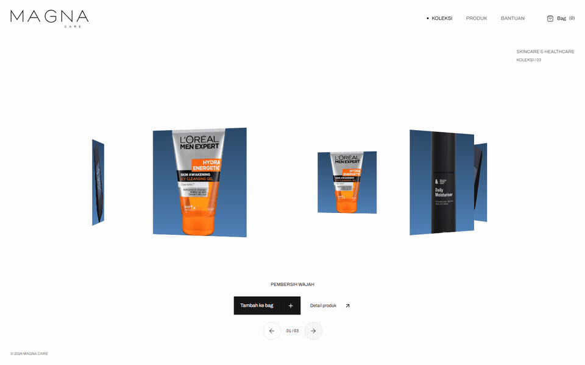

<a href="https://magna-care-one.vercel.app"><picture><source media="(prefers-reduced-motion: reduce)" srcset=".github/media/cover.png"></picture></a>

# Magna Care

A skincare storefront with an interactive 3D product ring, product dialogs and a local shopping bag.

**React · Vite · Tailwind CSS · Three.js** · Frontend storefront prototype

<table><tr><td>

### Open the website

**[magna-care-one.vercel.app](https://magna-care-one.vercel.app)**

The public demo is available in your browser. Scan the QR to open it on another device.

</td><td align="center" width="220"><a href="https://magna-care-one.vercel.app"></a><br><sub>Direct website link</sub></td></tr></table>

## Explore the storefront

- Drag, swipe, scroll or use the keyboard to browse the product ring.
- Open product dialogs and add items directly from the home gallery.
- Search and filter the catalog, inspect details and update the local bag.
- Responsive navigation, reduced motion and storage/image fallbacks.

The project was developed as a capstone for the Magna Global Internship at SGN.
Its gallery uses CSS3DRenderer, so the cards remain DOM controls rather than a WebGL scene.

## Run locally

Use **Node.js 24**.

```sh
git clone https://github.com/EGYYFZA/magna-care.git
cd magna-care
npm ci
npm run dev
```

Open the local URL printed by Vite, usually **http://localhost:5173**.

```sh
npm run lint
npm run build
```

## Demo boundary

Products, images and prices are design examples. There is no server inventory,
payment processing, delivery, account service or completed-order workflow.
Adding to the bag does not place an order. Use sample data only.

The bag stays in the current browser; when storage is unavailable it lasts for
the session. See [SECURITY.md](SECURITY.md).

## Assets

The wordmark is original project artwork. Editorial photography and font credits
are in [asset notices](public/ASSET-LICENSES.md). Existing product-image commercial
permissions remain unverified; replace them with authorized supplier media before
operating a commercial catalog.
